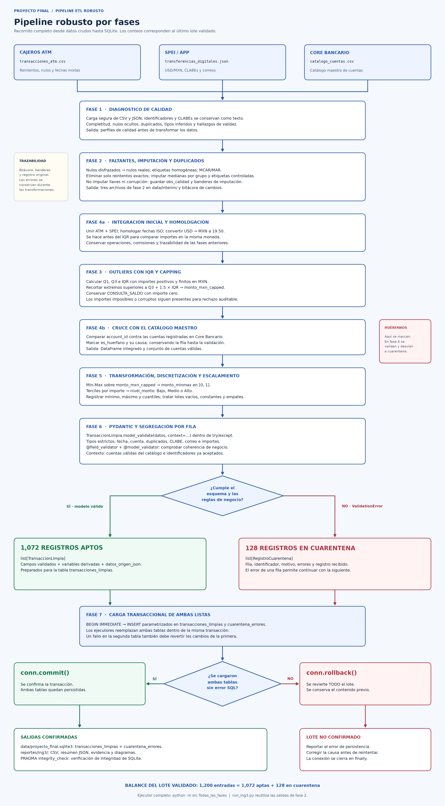

# REGLAS_DE_NEGOCIO.md
**Proyecto Integrador – Pipeline ETL Robusto con Zona de Cuarentena**
Ingeniería de Datos (ATD-2602) · Unidad 2 · TecNM Campus Colima · Ago–Dic 2026
**Grupo 2 (LCNT) – Fintech & Transacciones Bancarias** (Cajeros ATM + SPEI / App)

| Rol | Integrante | Fases |
|---|---|---|
| Ingeniera 1 – Calidad, Nulos y Outliers | Carol Ivette Rodríguez Lepe (23460709) | 1, 2 (y 3) |
| Ingeniero/a 2 – Transformación e Integración | _(nombre)_ | 4, 5 |
| Ingeniero/a 3 – Validación, Resiliencia y BD | _(nombre)_ | 6, 7 |

---

## 0. Diagrama de flujo del pipeline (Mockup)

[Abrir SVG](reportes/ing3/diagramas/pipeline_robusto_por_fases.svg) ·
[Fuente Mermaid editable](reportes/ing3/diagramas/pipeline_robusto_por_fases.mmd) ·
[Visor de los tres diagramas](reportes/ing3/diagramas/ver_diagramas.html)

El diagrama se genera automáticamente con los conteos del lote. Muestra las siete
fases y el orden real del ejecutor: la homologación de fechas y divisas de fase
4a precede al IQR de fase 3, para calcular umbrales sobre importes en MXN; después
fase 4b cruza el catálogo. Los corruptos e imposibles se conservan para validación
y rechazo auditable en fase 6. Las dos listas llegan juntas a una transacción de
fase 7: solo un commit confirma ambas tablas; cualquier fallo SQL revierte el lote.

---

## 1. FASE 1 – Diagnóstico de calidad inicial  *(Ingeniera 1: Carol Ivette Rodríguez Lepe)*

**Código:** `src/fase1_diagnostico.py` · **Evidencia:** `notebooks/Ing1_Fase1_Fase2_Calidad.ipynb`, `reportes/ing1/f1_*.csv`, figuras 02–03

Procedimiento (el mismo de la actividad de la sesión 22):
1. Cargar **sin convertir nada a NaN** (`keep_default_na=False, dtype=str`) para descubrir los nulos disfrazados → `f1_nulos_disfrazados.csv`.
2. Cargar de forma definitiva con **`na_values` explícitos** e identificadores como texto.
3. Contar nulos por columna, calcular el **% de completitud** y ordenar de menor a mayor → `f1_ranking_completitud.csv`.
4. Contar **duplicados exactos** (`df.duplicated().sum()`) y por llave primaria.
5. Revisar los **dtypes** (`df.dtypes` / `df.info()`) y los tipos Python mezclados.
6. Ver el patrón de nulos con **missingno** (`msno.matrix`, `msno.bar`, `msno.heatmap`).

### 1.1 Resultados del perfilado del dato crudo

| Dataset | Filas | Completitud global | Duplicados exactos | Duplicados por llave |
|---|---:|---:|---:|---:|
| catalogo_cuentas | 50 | 100.00 % | 0 | 0 |
| transacciones_atm | 620 | 98.57 % | **20** | **20** |
| transferencias_digitales | 600 | 99.73 % | 0 | 0 |

**Las 3 columnas más críticas** (menor completitud):

| # | Columna | Nulos | Nulos disfrazados | % completitud |
|---|---|---:|---:|---:|
| 1 | `transacciones_atm.id_cajero` | 44 | — | 92.90 % |
| 2 | `transacciones_atm.monto_mxn` | 27 | — | 95.65 % |
| 3 | `transferencias_digitales.notification_email` | 8 (`null`) | **8 (`""`)** | 97.33 % |

### 1.2 Reglas derivadas del diagnóstico

| ID | Regla | Justificación técnica |
|---|---|---|
| **R1.1** | Los identificadores (`id_cuenta`, `id_transaccion`, `transfer_id`, `account_id`, `id_cajero`, **`beneficiary_clabe`**) se leen **como texto**. | Con la carga por defecto pandas infiere la CLABE como `int64` y **elimina el `0` inicial** (código de banco `012`): 554 CLABEs válidas de 18 dígitos quedan en 17 y serían rechazadas por error. |
| **R1.2** | Nulos disfrazados: `pd.read_csv(..., na_values=NA_VALUES)` con `NA_VALUES = ['', ' ', 'N/A', 'NA', 'null', 'NULL', 'None', '-', '--', '?', 'nan', 'unknown', 'desconocido', 'S/D', ...]`. Como `read_json` no acepta `na_values`, en el JSON se reemplazan después de cargar. | 8 correos llegan como cadena vacía; `isna()` no los ve. Sin esta regla la completitud real se sobreestima y la prueba MCAR/MAR da una conclusión falsa (ver §2.3). |
| **R1.3** | Unicidad: se mide duplicado exacto (fila completa) y duplicado por llave primaria. | Los 20 duplicados de ATM coinciden en **todas** las columnas → son reintentos de cajero, no operaciones distintas. |
| **R1.4** | `timestamp` (JSON) se reporta como tipo mixto: 405 `str` ISO-8601 con zona `-06:00` + 195 `int` epoch Unix. | El `dtype` es `object`; se documenta para la Fase 4. |

### 1.3 Patrón visual (missingno)
* `msno.matrix`: los nulos de `monto_mxn`, `id_cajero` y `notification_email` aparecen **dispersos**, sin bloques ni zonas del archivo.
* `msno.heatmap`: la correlación de nulidad entre `monto_mxn` e `id_cajero` es **r = −0.03** → no faltan juntos.
* Ambas cosas son una primera señal de **MCAR**, que luego se confirma con pruebas (§2.3).

### 1.4 Hallazgos de validez transferidos a otras fases
(Detalle completo: `reportes/ing1/f1_hallazgos_validez.csv`)

| Hallazgo | Registros | Fase |
|---|---:|---|
| Fechas ATM en 3 formatos (`YYYY/MM/DD HH:MM:SS`, `DD/MM/YYYY HH:MM`, ISO) | 420 no-ISO | 4 |
| `timestamp` epoch Unix en JSON | 195 | 4 |
| Importes en USD | 134 | 4 |
| Cuentas huérfanas ATM / SPEI (no existen en catálogo) | 32 / 29 | 4 |
| `monto_mxn = 0` en **CONSULTA_SALDO** (válido) | 101 | 3 |
| Outliers ATM (máx. 3 500 000 MXN): IQR×1.5 / Z-score \|z\|>3 | 1 / 1 | 3 |
| Outliers SPEI (máx. 5 240 100): IQR×1.5 / Z-score \|z\|>3 | **18 / 12** | 3 |
| Montos negativos o ≤ 0 en operaciones monetarias | 0 | 3 |
| CLABE con longitud ≠ 18 (`'12345'`) | 46 | 6 |
| Correo con formato inválido (`correo@@sinformato`, `invalido.com`) | 30 | 6 |
| Comisión > 0 cobrada con `FALLO_CONEXION` | 92 | 6 (decisión de equipo) |
| Operaciones de cuentas BLOQUEADA/SUSPENDIDA (ATM / SPEI) | 222 / 213 | 6 (decisión de equipo) |
| CLABE de 18 dígitos que no pasa dígito verificador | 492 | Solo informativo* |

**IQR vs Z-score (actividad 3.1.2):** en SPEI el Z-score detecta 6 atípicos menos que IQR porque la media y la desviación estándar se calculan con los propios outliers y se inflan (efecto de enmascaramiento). Con datos tan sesgados se recomienda **IQR (Tukey)** para la Fase 3.

\* Los datos son sintéticos: el 89 % de las CLABEs de 18 dígitos falla el dígito verificador. **No** se recomienda usarlo como regla porque mandaría casi todo a cuarentena; la regla de la Fase 6 debe ser `^\d{18}$`.

---

## 2. FASE 2 – Manejo de faltantes e imputación  *(Ingeniera 1: Carol Ivette Rodríguez Lepe)*

**Código:** `src/fase2_imputacion.py` · **Evidencia:** `reportes/ing1/f2_*.csv`, `comparativo_*.csv`, figuras 01, 04–08

### 2.1 Orden de ejecución
1. Nulos disfrazados → `NaN` (R1.2) y etiquetas con `strip().upper()` (`'exitosa'`→`'EXITOSA'`: 85 en ATM; `'liquidada'`→`'LIQUIDADA'`: 121 en SPEI).
2. **Eliminar los 20 duplicados exactos** (`drop_duplicates()`, conservando la primera ocurrencia) **antes** de calcular medianas, para no contar dos veces el mismo reintento.
3. Clasificar ausencias (MCAR/MAR/MNAR).
4. Recalcular lo deducible → imputar numéricas → imputar categóricas.
5. Registrar cada imputación en la bitácora y marcar banderas `<col>_imputado`.

### 2.2 Método de clasificación MCAR / MAR / MNAR
Igual que en la sesión 22, se crea el indicador *falta = 1 / no falta = 0* y se revisa si se relaciona con **otra columna observada**:
* **Categóricas:** % de nulos en cada categoría (`groupby`) y la brecha entre la categoría con más y con menos nulos. Para saber si esa brecha es real o azar se aplica una **prueba χ² de independencia** (`scipy.stats.chi2_contingency`). Si alguna frecuencia esperada es < 5 (pasa con pocos nulos) la χ² clásica no es confiable y se usa su **p-valor por permutación** (5 000 permutaciones, semilla 2026).
* **Numéricas:** media y mediana de la otra variable **con dato vs sin dato**, y prueba **Mann-Whitney U** (no supone normalidad; los montos no son normales).
* α = 0.05. Si alguna prueba da p < 0.05 ⇒ **MAR** respecto a esa variable. Si ninguna ⇒ **MCAR**.
* **MNAR** no se puede probar con los datos (el valor que lo causaría es justo el que falta); se argumenta con conocimiento del negocio (§2.4).

### 2.3 Resultados

| Variable | n nulos | Brecha máx. de % nulos | Variables probadas (p-valor) | Clasificación |
|---|---:|---|---|---|
| `monto_mxn` (sin CONSULTA_SALDO) | 27 | 6.6 pp entre cajeros | tipo_operacion 0.588 · resultado 0.608 · id_cajero 0.351 · comisión 0.926 | **MCAR** |
| `id_cajero` | 42* | 5.0 pp entre tipos | tipo_operacion 0.410 · resultado 0.349 · monto 0.145 · comisión 0.202 | **MCAR** |
| `notification_email` | 16 | 4.3 pp entre conceptos | status 0.120 · currency 1.000 · concept 0.540 · platform 0.675 · amount 0.348 | **MCAR** |
| `comision_aplicada` | 0 | — | — | Sin nulos |
| `amount` | 0 | — | — | Sin nulos |

\* 44 en crudo; 2 estaban en filas duplicadas eliminadas en el paso 2.

> **Prueba de sensibilidad:** si no se detectan los 8 nulos disfrazados (`''`) y solo se usan los 8 `null`, la prueba sale significativa por `status` (p = 0.034) y se concluiría **MAR** por error. Con los 16 ausentes reales la dependencia desaparece (p = 0.120). Por eso los nulos disfrazados se tratan **antes** de clasificar.

> **Nota sobre `monto_mxn`:** CONSULTA_SALDO se excluye de la prueba porque su monto es **estructuralmente 0** y nunca falta; incluirla crearía una dependencia artificial con `tipo_operacion`.

### 2.4 Discusión de MNAR por columna
| Columna | ¿Podría faltar *por su propio valor*? | Conclusión |
|---|---|---|
| `monto_mxn` | Sería MNAR si los montos grandes se perdieran más. No se puede verificar, pero la falta no depende de `tipo_operacion`, `resultado`, `id_cajero` ni `comision_aplicada`, que sí están ligadas al monto, y en un cajero el monto lo registra el sistema, no el cliente. | MCAR |
| `id_cajero` | El ID lo escribe la terminal; su ausencia es una falla de telemetría y no depende de qué cajero era. | MCAR |
| `notification_email` | El cliente no registró correo; no tiene relación con el monto ni con el estado de la transferencia. | MCAR |

### 2.5 Reglas de imputación

| ID | Variable | Regla | Justificación |
|---|---|---|---|
| **R2.1** | `monto_mxn` (CONSULTA_SALDO) | **Recalcular = 0** | Equivalente fintech de `monto_total = cantidad × precio`: el valor se deduce de otra columna (`tipo_operacion`); una consulta no mueve dinero. En este lote no hubo consultas sin monto (0 registros), pero la regla queda activa y probada en `tests/`. |
| **R2.2** | `monto_mxn` | **Mediana por `tipo_operacion`** (calculada solo con montos > 0): RETIRO = 2 000; DEPÓSITO = 4 000; PAGO_SERVICIOS = 4 000. Respaldo: mediana global. | Ver §2.6 y §2.7. |
| **R2.3** | `amount` (SPEI) | **Mediana por `currency`** (MXN = 18 426.85; USD = 19 356.64). Hoy no hay nulos; la regla queda activa para lotes futuros y pruebas de estrés. | No se mezclan USD con MXN antes de la conversión de la Fase 4. |
| **R2.4** | `comision_aplicada` | `0.0` **se conserva** (no es nulo). Si llega `NaN` → mediana por `tipo_operacion`. | El 0.0 aparece en 27.3 % de los registros (sin duplicados) y su proporción no difiere significativamente entre resultados (χ² p = 0.058 > 0.05) → es **exención de comisión** (p. ej. cajero propio), no un nulo disfrazado. Las tarifas observadas son 0, 15, 25 y 34.80 (este último posiblemente 30 + 16 % IVA). |
| **R2.5** | `id_cajero` | Etiqueta controlada **`CAJERO_DESCONOCIDO`** | Categórica nominal: imputar la moda (`SimpleImputer(strategy="most_frequent")`) inventaría una ubicación física falsa. La etiqueta conserva el registro y lo hace auditable. Equivale a `SimpleImputer(strategy="constant", fill_value="CAJERO_DESCONOCIDO")` (verificado). |
| **R2.6** | `notification_email` | Etiqueta controlada **`ANONIMO`** | No se puede inventar un correo. El correo es de notificación (no transaccional), así que su ausencia no invalida la operación. ⚠ Ing. 3: el validador de email debe **aceptar** `ANONIMO` y rechazar solo formatos inválidos. |
| **R2.7** | Llaves e identificadores (`id_cuenta`, `account_id`, `transfer_id`, `id_transaccion`, `beneficiary_clabe`, `fecha_hora`/`timestamp`, `currency`, `tipo_operacion`) | **Nunca se imputan.** Si faltan → cuarentena (Fase 6). | Imputar una llave crea relaciones falsas; en banca es un riesgo de integridad y cumplimiento. |
| **R2.8** | Valor **presente pero corrupto** (ej. `monto='abc'`) | **No se imputa**: queda `NaN` y se anota en `obs_calidad` (`MONTO_MXN_NO_NUMERICO`). | Distinguir *ausente* (imputable) de *corrupto* (cuarentena) evita “lavar” datos basura. |
| **R2.9** | Trazabilidad | Columnas booleanas `monto_mxn_imputado`, `id_cajero_imputado`, `notification_email_imputado`, `comision_aplicada_imputado` (misma idea que `add_indicator=True` de `SimpleImputer`) + `reportes/ing1/f2_bitacora_imputacion.csv` (id, columna, valor, método, grupo). | Auditoría: cualquier valor imputado puede rastrearse. |

### 2.6 ¿Por qué la mediana y no la media?
* `monto_mxn` (> 0): **sesgo (skewness) = 22.2**, media = 11 229 vs mediana = 3 000. Un solo retiro de 3 500 000 MXN en un cajero arrastra la media 3.7 veces por encima de la mediana.
* `amount` (SPEI): sesgo = 7.5, media = 98 262 vs mediana = 18 449 (5.3 veces).
* La mediana tiene **punto de ruptura de 50 %** (hasta la mitad de los datos pueden ser extremos sin moverla); la media tiene punto de ruptura **0 %** (un solo outlier la cambia).
* Imputar con la media metería montos “típicos” que ningún cliente realiza; para RETIRO la media es **17 489** mientras la mediana es **2 000**.
* **Evidencia de que no se distorsiona:** tras imputar, la mediana de `monto_mxn` sigue en 1 500 MXN y la media cambia −1.0 % (9 316.53 → 9 225.33).

### 2.7 ¿Mediana global (`SimpleImputer`) o mediana por grupo?
`SimpleImputer(strategy="median")` (sesión 28) usa una sola mediana para toda la columna: **3 000 MXN**. Por tipo de operación la mediana es distinta (`f2_comparacion_simpleimputer.csv`):

| tipo_operacion | Nulos | Mediana global | Mediana del grupo | Media del grupo |
|---|---:|---:|---:|---:|
| DEPÓSITO | 7 | 3 000 | **4 000** | 4 741.67 |
| PAGO_SERVICIOS | 4 | 3 000 | **4 000** | 5 345.45 |
| RETIRO | 16 | 3 000 | **2 000** | 17 488.62 |

Con la mediana global, los 16 retiros quedarían 50 % arriba de un retiro típico. Por eso se usa `groupby('tipo_operacion').median()`: es la misma mediana, calculada dentro de cada grupo. Bajo MCAR ambas opciones son insesgadas, pero la mediana por grupo conserva mejor la distribución de cada tipo.

### 2.8 Resultado (antes → después)

| Dataset | Filas | Completitud global | Duplicados exactos |
|---|---|---|---|
| transacciones_atm | 620 → **600** | 98.57 % → **100 %** | 20 → **0** |
| transferencias_digitales | 600 → 600 | 99.73 % → **100 %** | 0 → 0 |
| catalogo_cuentas | 50 → 50 | 100 % → 100 % | 0 → 0 |

Imputaciones: 27 `monto_mxn` (mediana por tipo), 42 `id_cajero` (`CAJERO_DESCONOCIDO`), 16 `notification_email` (`ANONIMO`). **Ningún registro válido fue eliminado** en la Fase 2 (solo los 20 reintentos idénticos). Eliminar filas con nulos (`dropna`) habría descartado 68 de 600 operaciones (11.3 %).

### 2.9 Contrato de entrega a la siguiente fase
`data/interim/transacciones_atm_fase2.csv`, `data/interim/transferencias_digitales_fase2.json`, `data/interim/catalogo_cuentas_fase2.csv`
* Los outliers **siguen presentes** (se tratan en la Fase 3).
* ⚠ **Fase 3:** la regla “eliminar montos ≤ 0” **debe excluir CONSULTA_SALDO** (101 registros con monto 0 legítimo).
* Fechas, monedas y huérfanos **sin modificar** (responsabilidad de la Fase 4).
* `beneficiary_clabe` se entrega como **texto**; al leer el CSV/JSON indicar `dtype=str`.

---

## 3. FASE 3 – Outliers (IQR / Capping)  *(pendiente)*
## 4. FASE 4 – Integración, fechas, divisas y huérfanos  *(Ingeniero/a 2 – pendiente)*
## 5. FASE 5 – Min-Max y discretización *(integración de Ingeniero/a 3)*

**Código:** `src/fase5_transformacion.py`. Se usa el importe `monto_mxn_capped`,
ya convertido a MXN. Min-Max = `(x - mínimo) / (máximo - mínimo)`, con resultado
0 para lotes constantes. Se ajusta sobre importes numéricos finitos no negativos
recibidos de fase 4; se excluyen los corruptos del cálculo, conservando sus filas.

Se eligen terciles por la distribución sesgada de los importes: Bajo si
`x <= P33`, Medio si `P33 < x <= P67`, Alto si `x > P67`. Los montos iguales
siempre reciben la misma etiqueta. En lotes pequeños o constantes puede haber
segmentos vacíos. No se divide por orden de fila para forzar grupos del mismo
tamaño. Los umbrales y extremos se exportan a `reportes/ing3/resumen_ing3.json`.

## 6. FASE 6 – Pydantic y cuarentena *(Ingeniero/a 3)*

**Código:** `src/modelos_ing3.py`, `src/fase6_validacion.py`.

| ID | Regla | Justificación |
|---|---|---|
| R6.1 | `BaseModel` estricto, `extra='forbid'`, números finitos y sin booleanos como importes. | Un dato textual o corrupto no debe convertirse silenciosamente en una transacción conforme. |
| R6.2 | Identificadores textuales no vacíos; cuenta existente en catálogo; duplicados de identificador desviados a cuarentena. | Evitar llaves inventadas, huérfanos y dobles inserciones. |
| R6.3 | Fecha ISO válida en calendario, moneda MXN/USD y conversión coherente a 19.50. | Validar también el contrato recibido de las fases anteriores. |
| R6.4 | Importes positivos en operaciones monetarias; cero únicamente en `CONSULTA_SALDO` ATM; comisión ATM no negativa. | Preservar consultas legítimas y rechazar valores imposibles. |
| R6.5 | CLABE SPEI como texto con exactamente 18 dígitos ASCII, sin dígito verificador; no aplica a ATM. | Conservar ceros iniciales y respetar el origen sintético de los datos. |
| R6.6 | Correo con formato válido o `ANONIMO`; CLABE faltante no se imputa. | Respeta R2.6 y R2.7; no inventa datos sensibles. |
| R6.7 | Cada `ValidationError` conserva causas, posición de fila y contenido recibido. | Trazabilidad sin detener el lote; `entrada = limpias + cuarentena`. |

Los registros con valores imposibles también se conservan en cuarentena para
auditoría; no llegan a la tabla limpia. La integración conserva las consultas de
saldo cero, los tipos de operación, las comisiones y las banderas de calidad.

## 7. FASE 7 – Carga transaccional a SQLite *(Ingeniero/a 3)*

**Código:** `src/fase7_base_datos.py`. **Ejecutor:** `run_ing3.py`.
**Pruebas:** `tests/test_ing3_resiliencia.py`.

Una única transacción guarda `transacciones_limpias` y `cuarentena_errores` con
INSERT parametrizados. Se ejecuta `conn.commit()` al finalizar las dos cargas;
ante cualquier excepción, `conn.rollback()` revierte todo. Las conexiones se
cierran siempre. Las restricciones SQL refuerzan unicidad, nulidad y rangos.

Los ejecutores renuevan las dos tablas de forma atómica, sin acumular filas al
repetir el lote. Un fallo después de los DELETE restaura el contenido anterior.
La batería inyecta 20 000 registros (50 % corruptos) y provoca errores SQL reales
por duplicado y por trigger en cuarentena para demostrar rollback de ambas tablas.

La guía de ejecución, consultas SQL y defensa está en `docs/GUIA_ING3.md`.

### Decisiones de equipo abiertas (detectadas en la Fase 1)
1. ¿Las comisiones cobradas en `FALLO_CONEXION` (92) van a cuarentena o solo se marcan?
2. ¿Las operaciones de cuentas BLOQUEADA/SUSPENDIDA (222 ATM / 213 SPEI) son causa de cuarentena?

---

## Firmas de conformidad

| Integrante | Rol | Firma | Fecha |
|---|---|---|---|
| Carol Ivette Rodríguez Lepe | Ingeniera 1 – Calidad, Nulos y Outliers | | |
| | Ingeniero/a 2 – Transformación e Integración | | |
| | Ingeniero/a 3 – Validación, Resiliencia y BD | | |
